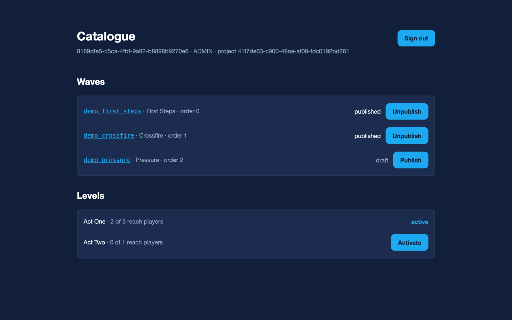

# R2 — who is calling, and the content write side

Split in two, like R1. **R2a**, here, is identity: signing in, renewing, and proving who a
caller is. **R2b** is the admin surface that uses it — authoring, validating and publishing
content — and the editor pointed at Python.

## Why identity came first, and why it is in R2 at all

The plan put identity in R3. That order cannot work. R2's job is the content _write_ side, and
an admin write surface with no authentication is an open write endpoint — anyone who can reach
the service can publish, unpublish and overwrite content. There is no version of that worth
shipping for one release and fixing in the next.

So identity moved forward. The plan is wrong on this point rather than the code being early.

## R2a acceptance criteria

|          | Criterion                                                                           | State |
| -------- | ----------------------------------------------------------------------------------- | ----- |
| **AC-1** | An account provisioned at startup can sign in and gets a token pair                 | green |
| **AC-2** | A wrong password, an unknown address and a disabled account are refused identically | green |
| **AC-3** | An access token proves a caller at `/api/v1/me`; no token is a 401                  | green |
| **AC-4** | The two token kinds are not interchangeable, in either direction                    | green |
| **AC-5** | Renewing rotates the refresh token; a rotated token cannot be used again            | green |
| **AC-6** | A rotated token coming back ends every session for that account                     | green |
| **AC-7** | Only a digest of a refresh token is stored                                          | green |
| **AC-8** | Startup refuses a missing or short signing key                                      | green |

## The claim that does the work

Two JWTs signed by the same key, for the same account, are interchangeable unless something
says they are not. The `typ` claim is that something, and it is checked rather than merely
present.

Without it nothing fails visibly: a refresh token — the one that lives for weeks — simply works
as a bearer credential, and a weeks-long _claim on a new session_ silently becomes a weeks-long
_session_. There are tests in both directions, because a check that only runs one way is a
rule that holds by accident.

Roles are read back through the same enum they were written from. A token carrying a role this
build does not have is refused rather than treated as a caller with no permissions — deny by
default, because "a caller with no permissions" is still a caller, and a route that forgot its
check would run as one.

## Rotation, and what a returning token means

Every renewal revokes the token it was given and issues a new one. If an already-rotated token
is presented, either the client lost a race or somebody else has a copy, and from the server
those look identical. Every live session for that account is revoked.

A legitimate client then has to sign in again, which is an annoyance. The alternative is
leaving a stolen token working for weeks, which is not.

## A bug the tests found

The first run of "renewing gives a new pair" failed on a unique constraint. Two tokens minted
in the same second for the same account were **byte-identical** — same subject, same role, same
`iat` — and a refresh token's digest is its primary key, so the second could not be stored.

Signing in and immediately renewing is an ordinary thing for a client to do. Tokens now carry a
`jti`, a unique id per issuance. Reasoning about the token design would not have found this;
running it did.

## Startup refuses more than it used to

- **No signing key, with a database configured** → refuse to start. A generated or defaulted key
  would let the service boot and issue tokens anybody holding this source can forge, and nothing
  about the running service would look wrong.
- **A signing key under 32 bytes** → refuse to start. RFC 7518 §3.2 asks for a key at least as
  long as the hash it feeds, and this is the one secret that lets anybody mint an administrator.
- **No database at all** → signing in answers `503`, not `401`. Telling a caller their
  credentials were wrong when nothing could ever accept them is a lie that costs somebody an
  afternoon.

The bootstrap administrator is created with `on conflict do nothing`, so a restart cannot
overwrite a password somebody changed — otherwise whatever was in the environment at deploy
time silently becomes the password forever. There is a test that changes the stored hash,
restarts, and checks the old password still does not work.

## R2b — the authoring surface

Done. Create, replace, publish, unpublish, delete, bulk import, and the level routes the editor
uses, all behind a role.

|           | Criterion                                                                            | State |
| --------- | ------------------------------------------------------------------------------------ | ----- |
| **AC-9**  | Authoring is closed without a token; a viewer may read drafts but not change them    | green |
| **AC-10** | A document is validated against the project's schema before anything is stored       | green |
| **AC-11** | A stored document comes back byte for byte, through the editor and the API           | green |
| **AC-12** | A save is not a publish: replacing a live wave leaves it live                        | green |
| **AC-13** | Publishing moves the content hash, so a polling client learns there is something new | green |
| **AC-14** | A bulk import is all or nothing, and names a bad document by position                | green |
| **AC-15** | **The existing editor works against Python with no change**                          | green |

### The editor, unchanged, on Python

Nothing in `editor/` was touched. The Next.js app signed in, listed the catalogue, opened
`demo_crossfire`, added a movement, saved it, and the change reached PostgreSQL and moved the
public ETag. The project's own `scripts/import-waves.mjs` loaded all three demo waves through
the bulk endpoint.

That is the criterion R1 claimed and could not meet, met here.

### What the import script taught us

The first run of `import-waves.mjs` against Python failed with **405**. The script posts to
`/api/v1/admin/waves/bulk`, which had been left for later as "nice to have". It is not: it is
how content gets into the service, and a real client of the frozen contract was broken by its
absence.

It is transactional and it **splits** the array rather than parsing it. Parsing and
re-serialising the elements would rewrite `2.0` as `2` and reorder keys, moving the ETag of
every wave in the batch — the same reason the raw route never re-serialises. `raw_decode` gives
each element's byte range, so the stored bytes are the author's.

A test caught a hole in that splitter: `[] []` was accepted as an empty batch, because the
empty-array path returned before the "nothing follows" check. Two values are not one value.

### Errors an author can act on

- **400** the body could not be read — not JSON, or not an array.
- **422** it was read and is not acceptable — with a JSON Pointer: `/progression_config/order`,
  `/spawn_rules`, or `/2/spawn_rules` for the third document of a batch.
- **409** creating a wave that already exists; `PUT` replaces.
- **422** a document whose `id` disagrees with the path. Two sources for one identity, and
  anything but a refusal can silently rename a wave or overwrite a different one.
- **422** two waves claiming one play position, naming `/progression_config/order` rather than
  letting a unique-index violation reach the client as a 500.

### Still owed

Level authoring — create, update, delete — has no route yet. The editor only lists and
activates levels, so nothing is blocked by it, and the two levels in the screenshot were seeded
with SQL. It belongs with the rest of the admin surface and is the first thing in R2c.
